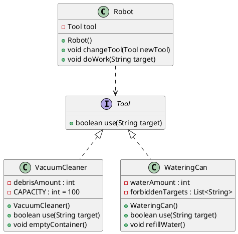

Create a `Robot` that can perform various household tasks, such as vacuum cleaning and watering plants.

Implement the exercise according to the UML diagram below. A dashed line with a filled arrow means that the `Robot` class uses the `Tool` interface: the `Robot` class contains an attribute whose type is `Tool`.

Textual description

The following is a description of the classes and their required features (corresponding to the UML diagram):

The `Robot` class has the following methods:

- `void changeTool(Tool tool)`: Changes the tool used by the robot (for example, a vacuum cleaner or a watering can).

- `void doWork(String target)`: Performs a household task with the currently selected tool by calling the tool's `use(target)` method. If `use` returns `false` (for example, a `WateringCan` object must not be used on the target `"Computer"`, or the tool has run out of water or space), the robot should print an error message. If no tool has been selected yet, the robot prints a message and does nothing. The robot itself does not know *why* a task failed; it only sees the boolean result.

- A `WateringCan` object does not water if there is not enough water available, and it refuses to water the targets on its forbidden list (`forbiddenTargets`, a list of strings; it contains at least `"Computer"`). Refusing does not use any water. It can be refilled back to the full 50 units using the `refillWater()` method. The watering can initially contains 50 units of water; one watering uses 20 units. If you wish, you may create an additional constructor that allows a different initial water level.

- A `VacuumCleaner` object does not vacuum if its dust container is full. The container can be emptied using the `emptyContainer()` method. A new vacuum cleaner starts with an empty container; the container capacity (`CAPACITY`) is 100 units and one round of vacuuming adds 30 units of debris. If you wish, you may create an additional constructor that allows a different initial fill level.

- Both tools return a boolean value from the `use(String target)` method indicating whether the task was completed successfully. The tools may also print messages of their own.

A main program has been provided on the exercise page, which you can use to test your classes.

